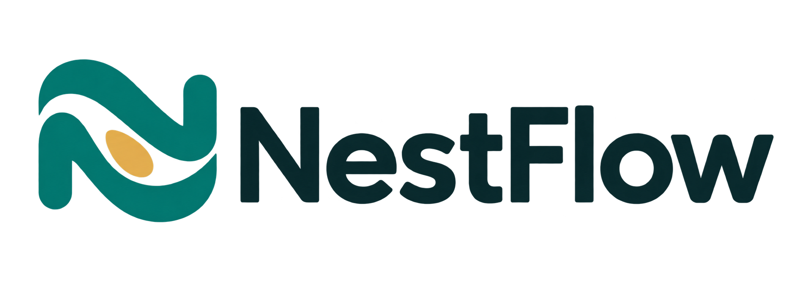
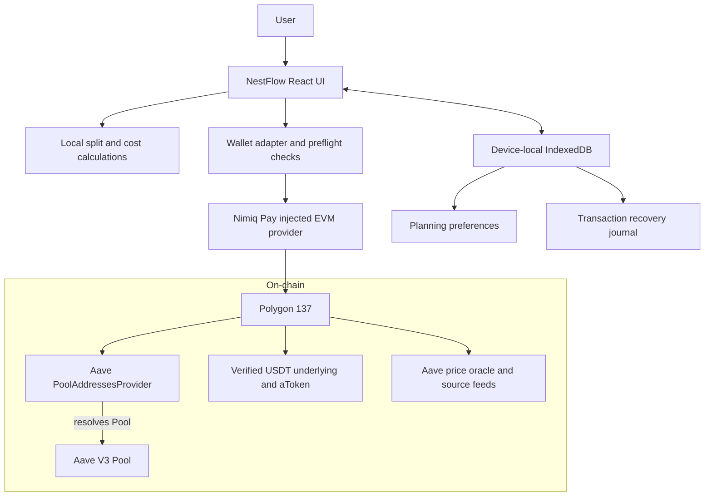
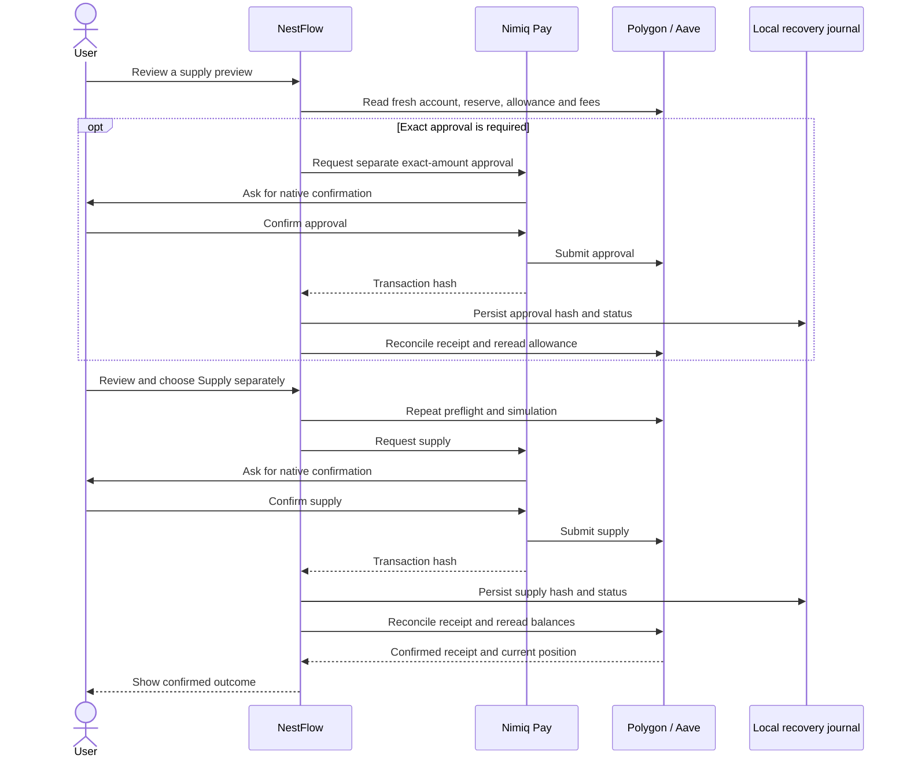

<p align="center">
  
</p>

# NestFlow

Room to spend.

NestFlow is an independent, self-custodial Nimiq Pay mini-app for deciding how much Polygon USDT/USDT0 to keep in your wallet and previewing supply to Aave V3. It reads an existing supported position, estimates costs and variable-rate earnings, checks withdrawals, and reconciles interrupted transactions. Aave provides lending infrastructure; NestFlow is independent of Aave and Nimiq.

**Normal builds disable real sends. Funded installed-device transactions remain unverified.** No backend, custom contracts, private-key storage, payment sending or automatic fund movement. MIT licensed; see [LICENSE](LICENSE) and [changelog](CHANGELOG.md).

## Why NestFlow exists

Supplying a small stablecoin balance can look attractive until entry fees, future withdrawal costs and near-term spending needs are considered together. NestFlow brings those decisions into one wallet-based workflow: choose what to keep available, inspect what a proposed supply could earn after estimated costs, and understand the checks needed to withdraw.

It is built for Nimiq Pay users with discretionary Polygon USDT/USDT0, including people who already hold the supported Aave position. Changing a spending preference is planning only: it does not reserve funds, rebalance a position or initiate a payment.

## What is distinctive

NestFlow's contribution is the combination of spending-aware planning, cost visibility and recoverable wallet actions. It uses existing Aave V3 infrastructure; it does not introduce a new lending protocol or claim a higher underlying rate than the same reserve elsewhere.

| Design choice | What it helps you understand |
|---|---|
| **Keep-in-wallet preference and live split** | See confirmed balances separately from the allocation after a proposed supply. Adjust the plan without moving funds. |
| **Costs before commitment** | Compare entry costs, estimated exit costs, holding period, lower-rate scenarios, net return and fee break-even when the required data is available. |
| **Manual payment-shortfall check** | Compare an entered payment amount with wallet funds and check a separate candidate withdrawal. Payment execution remains outside NestFlow. |
| **Explicit uncertainty** | Read block/time provenance, unavailable states and the visible USDT feed-age warning instead of treating missing data as zero or as verified freshness. |
| **Recovery before retry** | Reconcile saved transactions after reopening; keep approval separate from supply and block duplicate sends while an outcome is pending or unknown. |
| **Existing-position access and independent exit** | Inspect the supported position even if it originated elsewhere, with instructions for accessing the same market outside NestFlow. Installed-device exit compatibility remains unverified. |

For example, with **5 USDT in the wallet** and **2 USDT already supplied**, choosing to keep **3 USDT** previews a further **2 USDT supply**. The proposed split becomes 3 in the wallet and 4 supplied, excluding subsequent earnings. The confirmed balances stay unchanged until a separate transaction succeeds. These are illustrative amounts, not an observed account or a fee estimate.

## How it works

1. **Connect and verify.** Request wallet access through Nimiq Pay's injected provider, confirm Polygon 137, resolve the Pool and independently verify the supported token/reserve.
2. **Read the current position.** Fetch wallet USDT, POL, supplied balance, reserve state and the variable rate. Keep observations tied to their block and time.
3. **Plan locally.** Choose a wallet spending amount and holding period. Preview the proposed split, costs and earnings; no wallet transaction occurs when changing inputs.
4. **Check the intended action.** Validate allowance, balances, gas, reserve constraints and simulation where supported. Withdrawals also consider liquidity and debt/collateral.
5. **Reconcile the result.** In an expressly authorized private build, review each action in the wallet, save its hash and wait for receipt/state reconciliation. Normal public builds stop at reads, previews and checks.

### Architecture

The browser talks to the wallet's EVM provider. There is no NestFlow backend or separate account system. All token calculations use bigint base units; local storage holds planning preferences and recovery records, not authoritative balances.



The AddressesProvider resolves the Pool; token identity is checked independently. POL prices support optional cost conversion. A failed optional quote or history read does not by itself prevent otherwise eligible withdrawal checks.

### Approval, supply and recovery

**The following lifecycle applies only to separately authorized private transaction tests. Public builds keep real sends disabled.** Each approval, supply and withdrawal is subject to the private build's 5-USDT per-action cap.



This diagram shows the successful path. A required nonzero-allowance reset is another separately reviewed approval. Rejection does not trigger an automatic retry; a failed or uncertain receipt does not become success. On reopening, NestFlow reconciles the saved account, chain, action and hash before another send. Approval does not supply tokens, and a transaction hash is not confirmation.

## Technology and project layout

React and TypeScript provide the UI; Vite builds the static application. viem handles EVM reads, simulation and transaction preparation. TanStack Query supports client-side data handling, and idb wraps IndexedDB. Vitest, Playwright and Foundry/Anvil cover local logic, browser behavior and fork execution.

| Location | Purpose |
|---|---|
| [src/App.tsx](src/App.tsx) | Overview, planning, supply preview and withdrawal UI |
| [src/lib/](src/lib/) | Money math, wallet adapter, quotes, history and recovery |
| [src/config/](src/config/) | Sourced contract configuration and ABIs |
| [e2e/](e2e/) | Synthetic-provider browser tests and production send guard |
| [scripts/](scripts/) and [test/](test/) | Configuration checks and Polygon fork harness/tests |
| [docs/brand/](docs/brand/) | Supplied logo masters and brand guidance |
| [docs/BACKLOG.md](docs/BACKLOG.md) | Scope, milestone decisions and deferred ideas |
| [docs/RELEASE-CHECKLIST.md](docs/RELEASE-CHECKLIST.md) | Device, deployment, submission and demo verification steps |

## Setup and checks

Use Node.js 22.19+ and npm. From this checkout:

```powershell
npm ci
npm run dev
```

Open the Vite URL. Without an injected `window.ethereum` provider, the app explains how to connect; missing balances are never shown as zero. No RPC secret is needed for the browser UI. Never put keys or credentials in `VITE_*` variables: Vite embeds them in the browser bundle.

```powershell
npm run typecheck
npm run lint
npm test
npm run test:e2e -- --reporter=line
npm run test:e2e:production -- --reporter=line
npm run build
```

Install Playwright Chromium with `npx playwright install chromium` if absent. Run browser suites sequentially: they share `dist/` and port 4175. E2E mode uses a synthetic EIP-1193 provider and local execution guards; never deploy that artifact. The production check rebuilds normally and verifies disabled approve/supply/withdraw controls and no send RPC calls. Finish with the normal build.

Optional configuration and Polygon fork checks need Foundry/Anvil and an upstream Polygon RPC URL. Copy `.env.example` to ignored `.env`, set `POLYGON_RPC_URL` (and optionally `POLYGON_FORK_BLOCK`), then run:

```powershell
node --env-file=.env node_modules/tsx/dist/cli.mjs scripts/verify-config.ts
node --env-file=.env node_modules/tsx/dist/cli.mjs scripts/test-fork.ts
```

Fork transactions execute on local Anvil; upstream Polygon receives reads. Keep `.env` private. See [Core logic and fork tests evidence](docs/M1-VERIFICATION.md) and [security/maintenance limits](SECURITY.md).

## Load in Nimiq Pay — Custom URL

1. Build normally with the funded flag absent/false; serve `dist/` at a phone-reachable HTTPS URL. Configure SPA fallback to `index.html` for `/history`, `/independent-exit` and `/diagnostics`.
2. On the phone, open Nimiq Pay → **Mini Apps** → **Custom URL**. Enter the full HTTPS URL and open it, reviewing any unfamiliar-app warning.
3. Connect on every open. Review the native account permission and Polygon switch dialogs; NestFlow rereads the account and chain afterward. The expected chain is Polygon 137 (`0x89`).
4. Check the account, observation time and balances. Use **Refresh balances** after changes. Keep POL for network fees; USDT alone does not pay these contract-call fees.

For local LAN development, run `npm run dev -- --host`, use the same Wi-Fi, and enter `http://PC-LAN-IP:5173` in Custom URL. Phone localhost points to the phone. LAN HTTP can lack secure-context APIs; use HTTPS for device verification. Nimiq Pay’s Nimiq testnet setting does not change EVM calls to a testnet. Source: [Nimiq’s loading guide](https://nimiq.dev/mini-apps/development/load-local-mini-app), checked 2 November 2026. Full walkthrough: [manual tests](docs/nimiq-pay-manual-tests.md).

## Usage

- **Overview:** read confirmed wallet/supplied balances and set Keep in wallet plus holding days. The split is an after-supply preview. Moving it changes only a plan; it never moves existing supplied funds. Planning inputs are device-local and shared across accounts; Reset planning preferences retains the recovery journal.
- **Preview supply:** review the exact amount, remaining entry costs, estimated exit costs, rate source/time and lower-rate scenarios. Estimates can change. Approval permits only the exact amount for the verified Pool; a required zero reset is separate. Approval does not supply USDT. Supply requires its own reviewed action and confirmed receipt. Real-send buttons remain disabled normally.
- **Withdraw:** enter an amount and choose Check withdrawal. Read timestamped reserve/liquidity/debt/collateral diagnostics. A balance alone does not establish availability. A later payment is separate. The manual shortfall calculator compares an entered payment with wallet funds; it sends no payment.
- **Recovery:** refresh/reopen to reconcile saved receipts before any retry. Pending/unknown actions block duplicate sends. A hash is not confirmation. Replacements require matching sender/nonce and original call details before releasing a lock.
- **Confirmed history:** view confirmed supplies/withdrawals and export CSV with provenance. Forecasts and approvals are separate; missing logs never become earnings.

## Verified versus assumed

| Evidence | What it establishes | What it does not establish |
|---|---|---|
| [Wallet interface tests](docs/m3-test-results.md), [Transaction recovery and withdrawal checks](docs/m4-test-results.md), [History, price feeds and security review](docs/m5a-test-results.md) | User-reported Android provider/connect/switch/Polygon reads/rejection observations; synthetic browser and local Anvil results | Funded installed-device transaction compatibility; observations were not repeated during the design and accessibility review |
| [Design and accessibility review](docs/m5b-test-results.md) | Local unit/browser/production guard checks, all-route phone/desktop design review and unchanged supplied logo B | Complete screen-reader or physical-device accessibility certification |
| Independent exit instructions | Exact-market/account/token comparison steps are present and reviewed | Aave connection/withdrawal works in installed Nimiq Pay; this remains untested |
| Rate/cost/history displays | Sourced observations with timestamps and explicit unavailable states | Future rate, fee, liquidity, complete lifetime earnings or investment outcome |

## Limitations and independent exit

Only the configured Polygon Aave V3 reserve is supported; a token symbol alone is insufficient. Pool is resolved through PoolAddressesProvider; underlying USDT identity is independently checked. Addresses and source references live in [configuration](src/config/aave.ts). Protocol, stablecoin and liquidity risks apply; use discretionary funds you do not need immediately.

History covers at most the last 2,000 blocks in 500-block RPC pages. Providers may reject history queries. External aToken transfers are not interest; lifetime earnings reconstruction is unavailable. POL conversion requires a fresh WPOL feed update (within one hour) and positive Aave oracle prices at one block. The USDT adapter can lack `latestRoundData`: its oracle price still contributes to the ratio, with visible “USDT price feed age unverified” metadata. If a USDT timestamp is readable it is validated too. Net return and break-even use an available quote plus complete fee estimates; an unknown USDT feed age is disclosed rather than suppressing them. History, price feeds and security review’s former blanket rejection is superseded by the [POL quote fix verification](docs/pol-quote-test-results.md). Optional quote/history failure does not block otherwise eligible withdrawal checks.

IndexedDB is required for durable recovery. Clearing browser data can remove local records; chain state remains authoritative. There is no background reconciliation. Vite’s bundle-size warning and development dependency findings remain documented in [History, price feeds and security review evidence](docs/m5a-test-results.md) and SECURITY.md.

If NestFlow is unavailable, open [Aave’s application](https://app.aave.com/) with compatible wallet access, connect the **same account**, choose **Polygon V3 (137)**, and compare the underlying USDT/USDT0 and aToken with the sourced configuration. Keep POL for gas. Review liquidity and debt/collateral limits, then independently review a withdrawal in the wallet and wait for its receipt before retrying. Never export/share a seed phrase. See `/independent-exit` in the app and [the full steps](src/IndependentExit.tsx). Compatibility with installed Nimiq Pay remains unverified.

## Controlled real-send builds — separate authorization required

This documentation does not authorize funding or a transaction. The existing switch is `VITE_ENABLE_FUNDED_TEST_SENDS`: only the exact string `true` in a private build enables real sends. Funding, a URL parameter or runtime UI cannot enable it. After separate written authorization for account, Polygon/token/Pool, amount and POL budget, an operator may build privately as described in [the funded-build procedure](docs/nimiq-pay-manual-tests.md#m4-private-funded-build-switch--remains-off).

The adapter enforces **5 USDT (5_000_000 base units) per action**, covering approval, supply and withdrawal; any zero-reset approval is separate. This is not a cumulative/session cap or a POL-fee cap. No unlimited/full-balance sentinel bypasses it.

Serve such an artifact only at the controlled private test URL. Public deployments must have the flag absent/false in the shell, hosting build environment and applicable `.env*` files, then be rebuilt normally. Removing the flag after building does not disable an existing artifact. Run the production guard check on the normal build before public deployment. The current project remains send-disabled; Design and accessibility review performed no real sends.

## Future improvements

These are proposed next steps, not completed features or permission to expand scope. Implementation remains subject to the gates in [AGENTS.md](AGENTS.md) and the [backlog](docs/BACKLOG.md).

| Priority | Improvement | Evidence needed before calling it complete |
|---|---|---|
| Device validation | Exercise exact approval, supply, withdrawal, rejection and reload while pending in installed Nimiq Pay | Separate written authorization for the account, amounts and POL budget; native wallet observations, receipts and balance reconciliation |
| Independent exit | Verify compatible access to the same Polygon V3 position outside NestFlow | Installed-device walkthrough; any actual withdrawal requires its own authorization |
| Accessibility and usability | Broaden physical-phone, screen-reader and keyboard testing; collect consented task feedback | Observed user tasks, identified barriers and reviewed fixes |
| Performance and maintenance | Reduce the main bundle and review dependency upgrades | Before/after measurements, dependency review and passing regression/send-guard checks |
| History and earnings | Investigate wider reliable history coverage and principal/transfer-aware earnings reconstruction | Verified log coverage and accounting; incomplete data must remain explicitly unavailable |
| Release evidence | Record an accurately labeled demo and complete the submission review | Reviewed recording and current rules/scoring review, with mock, fork and installed-device evidence clearly separated |

## Contributing

Start with [AGENTS.md](AGENTS.md), [the product decisions](docs/PLAN.md) and [the backlog](docs/BACKLOG.md). Keep changes small, preserve bigint money calculations and transaction recovery, and add meaningful verification for changed behavior. Never commit credentials or present synthetic/fork tests as funded installed-device results. Follow [SECURITY.md](SECURITY.md) for vulnerability reporting and dependency-review limits.

Release preparation: [release checklist](docs/RELEASE-CHECKLIST.md) and [wording changes](docs/WORDING-REVIEW.md).

## License

Copyright (c) 2026 Dele Abdul Rauf. Released under the [MIT License](LICENSE).
